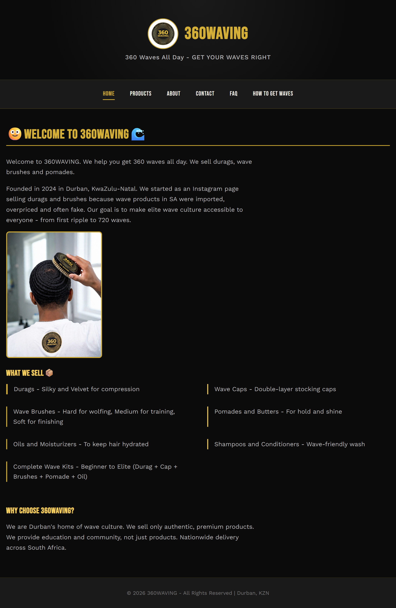
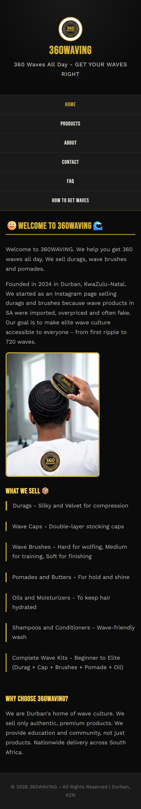

# 360WAVING — Website
**Student:** Z Tembe — ST10515337  
**Module:** WEDE5020 - Web Development (Introduction)  
**Location:** Durban, KwaZulu-Natal  
**GitHub:** https://github.com/Cebo1717/ST105153378_WEB-D-PART-2  
**Live site (Netlify):** https://360waving.netlify.app

360WAVING is an e-commerce brand website for a beauty, grooming and streetwear business selling wave-care products (durags, wave caps, brushes, pomades, oils, shampoos, and kits), with nationwide delivery across South Africa.

**Part 1** planned the site and built the HTML structure. **Part 2** added CSS styling and responsive design. **Part 3** (this version) adds JavaScript functionality, SEO, validated forms, and deployment.

---
## Project Structure
```
├── index.html               Home page (welcome, features, dynamically loaded wave tips)
├── products.html            Product catalogue (loaded from JSON, search / filter / sort, cart)
├── gallery.html             Photo gallery with lightbox            (NEW in Part 3)
├── about.html               Brand story, tabs (mission/vision/values/audience), interactive map
├── contact.html             Contact details, validated contact form, e-mail compiler, map
├── enquiry.html             Validated enquiry form with instant cost / availability response (NEW)
├── faq.html                 Accordion FAQ with live search
├── how-to-get-waves.html    Step-by-step guide to 360 waves
├── 404.html                 Custom "page not found" page                   (NEW)
├── style.css                Single external stylesheet (sections 1-14)
├── robots.txt               Crawler instructions                           (NEW)
├── sitemap.xml              Site map for search engines                    (NEW)
├── _headers                 Security + caching headers for Netlify         (NEW)
├── data/
│   ├── products.json        Product catalogue data (7 products)
│   └── tips.json            Wave tips posts (6 posts)
├── js/
│   ├── main.js              Helpers, mobile nav, scroll-reveal, back-to-top, shopping cart
│   ├── products.js          Dynamic product rendering, search, filter, sort, quick-view modal
│   ├── ui.js                Accordion, tabs, lightbox gallery, "load more" wave tips
│   ├── map.js               OpenStreetMap embed + geolocation distance
│   ├── forms.js             Form validation, AJAX submission, enquiry response, e-mail compiler
│   └── data-fallback.js     Copy of the JSON used if fetch() is blocked (e.g. opening from file://)
└── IMG/                     Optimised WebP images with descriptive file names + icons
    └── screenshots/         Desktop / Tablet / Mobile evidence (PDF + PNG)
```

---
## Part 2 Feedback: Corrections Made in Part 3

The Part 2 marking rubric returned marks but no written comments, so I treated **every criterion that did not get full marks** as feedback to act on:

| Part 2 criterion | Mark received | What I changed in Part 3 to improve it |
|------------------|---------------|-----------------------------------------|
| Feedback for Part 1 / changelog | 7/10 | Wrote a detailed, dated changelog with one row per change, each naming the files affected; documented every Part 2 correction below. |
| Decoration and colour | 4/5 | Added gradients, glows, branded text selection, themed scrollbar, `caret-color`, `accent-color`, consistent gold/black palette on all new components (CSS section 15). |
| Pseudo-classes | 8/10 | Added `:focus-visible`, `:focus-within`, `:checked`, `:disabled`, `:target`, `:not()`, `:is()`, `:has()`, `:nth-child()`, `:first-child`, `:last-child`, `:only-child`, `:empty`, `:visited`, `:active`, `::selection`, `::placeholder`, `::marker`, `::first-letter` (CSS section 15). |
| Media queries / breakpoints | 9/10 | Added breakpoints at 1400, 900, 768, 600 and 480 px plus landscape-phone, `hover: none`, `prefers-reduced-motion`, `prefers-contrast` and print queries; checked for horizontal overflow at 320, 375 and 768 px. |
| Adjustment - navigation menu | 4/5 | Menu collapses into an animated hamburger button at 768 px and below, with `aria-expanded`, Esc to close, active page highlighted and a cart button. |
| Adjustment - images | 4/5 | Responsive images with `srcset` and `sizes` (480 px and full-size WebP), `max-width: 100%`, `aspect-ratio`, explicit width/height and lazy loading. |
| Project pushed with multiple descriptive commits | 3/5 | Work is committed in small, single-purpose commits using a `feat:` / `fix:` / `style:` / `docs:` / `perf:` prefix (see `git log`). |
| README contains all relevant information | 3/5 | Rewrote the README: structure, features, how to run, accessibility, SEO, security, testing, deployment and references. |
| Changelog contains a record of development | 2/5 | Full Part 3 changelog with dates and file names (below). |

Other problems I found myself while auditing Part 2:

| Area | Problem found in Part 2 | Correction made in Part 3 |
|------|-------------------------|---------------------------|
| File names / links | Files were committed as `Index.html` and `Style.css`, but pages linked to `index.html` and `style.css`. This works on Windows but **breaks on GitHub Pages / Netlify** (Linux is case-sensitive): the Home link and the stylesheet would 404. | Renamed every file to lowercase (`index.html`, `style.css`, `products.html`, `about.html`, `contact.html`, `faq.html`, `how-to-get-waves.html`) and updated every link. Uses `git mv` so history is preserved. |
| README evidence | README showed screenshots from `IMG/screenshots/`, but the files sat in the repository root, so the images were broken. | Moved the PNGs and PDF into `IMG/screenshots/` with clean names. |
| Heading structure | The logo/brand was an `<h1>` on every page, so no page had its own `<h1>` describing its content. | Brand is now a link in the header; each page has exactly one descriptive `<h1>` in `<main>`, followed by `<h2>`/`<h3>` in order. |
| Images | Photos were 300-600 KB each and were WebP data saved with a `.jpg` extension; names such as `Durag.jpg` said nothing for search engines. | Converted to compressed WebP (about 40-70 KB each, ~85% smaller), with descriptive names such as `silky-velvet-durag-360-waves.webp`; added `width`/`height` and `loading="lazy"`. |
| Semantics | On the "How To Get Waves" page the final-result section sat outside `<main>`. Pages had no `lang` attribute. | Moved it inside `<main>`/`<section>`; added `lang="en-ZA"` and a skip-to-content link. |
| Consistency | Footers differed on every page. Contact e-mail and phone were plain text. FAQ mentioned `PROCESS.html` as text. | One consistent footer (links, social, copyright); e-mail and phone are `mailto:`/`tel:` links; FAQ links to the guide page. |
| Security | The external GitHub link opened a new tab without `rel="noopener noreferrer"`. | Added `rel` to all `target="_blank"` links. |

---
## Part 3 - Enhancing Functionality and SEO

### 2.1 Interactive elements
| Requirement | Where | How it works |
|-------------|-------|--------------|
| **Accordion** | `faq.html` (`js/ui.js`) | Each question is a `<button aria-expanded>` that opens its answer with a height animation. Keyboard: Enter/Space, Up/Down, Home/End. "Expand all / Collapse all" buttons and a live search box that filters questions. Questions can be linked directly, e.g. `faq.html#delivery`. Marked up with FAQ structured data. |
| **Tabs** | `about.html` (`js/ui.js`) | Mission / Vision / Values / Audience in an ARIA tab list. Left/Right arrow keys, Home/End. |
| **Modals** | Cart, product quick view, lightbox (`js/main.js`, `products.js`, `ui.js`) | Built on the native `<dialog>` element: focus is trapped, Esc closes, clicking the backdrop closes. |
| **Interactive maps** | `about.html` and `contact.html` (`js/map.js`) | **OpenStreetMap** embedded map of the Durban base with a pin: drag to move, + / - buttons to zoom, and an "Open this location in a larger map" link. No API key is needed, so it works on any host. On the contact page, "How far am I from you?" uses the **Geolocation API** and the Haversine formula to show the distance from the visitor to the Durban base, with a **Get directions** link. |
| **Animations and transitions** | `style.css` section 13, `js/main.js` | Scroll-reveal fade-ups using `IntersectionObserver`, card hover lifts, animated accordion icon, modal zoom-in, cart badge "bump", toast pop-up, logo spin on hover, button loading spinner. All animation is switched off for visitors with *prefers-reduced-motion*. |
| **Advanced DOM manipulation** | all `js/*.js` | Elements are created with `createElement`/`textContent` (never `innerHTML` with data), event delegation on the gallery, `IntersectionObserver`, `URLSearchParams` (e.g. `products.html?category=kits`), `localStorage`, live character counters, show/hide of form fields depending on the chosen enquiry type. |
| **Gallery + lightbox** | `gallery.html`, home page, guide page (`js/ui.js`) | 9-photo responsive grid. Clicking a photo opens a full-size viewer with Previous / Next / Close buttons, Left/Right/Esc keys, swipe on touch screens, caption and "Image 3 of 9" counter. Without JavaScript the links simply open the image. |

### 2.2 Dynamic content
- **Dynamic loading:** `products.html` fetches `data/products.json` and builds the product cards with JavaScript. The home page fetches `data/tips.json` and shows 3 posts at a time with a **Load more tips** button.
- **Search, filter and sort (Products):** live keyword search (name, description, tags, category), category filter, sort by price (low/high) or name, results counter, "no results" message and Reset button.
- **Shopping cart:** Add to cart buttons, cart badge in the navigation, a cart modal where quantities can be changed or items removed, running total, saved in `localStorage` so it survives page changes, and an **Order on WhatsApp** button that prefills the order message.

### 3. Search Engine Optimisation (SEO)

**3.1 On-page SEO**

| Technique | What was done |
|-----------|---------------|
| Keyword research | See the keyword table below. Each page targets its own main phrase and uses it in the title, description, `<h1>`, first paragraph and image `alt` text. |
| Title tags and meta descriptions | Unique `<title>` (under about 60 characters) and a unique `<meta name="description">` (about 150 characters) on every page, written as short invitations to click. |
| Meta keywords | A page-specific `<meta name="keywords">` list on every page (Google ignores it, but it documents the research). |
| Header tags | One `<h1>` per page, then `<h2>` sections and `<h3>` sub-sections; no skipped levels. |
| Image optimisation | Descriptive file names, meaningful `alt` text, WebP compression, explicit width/height, lazy loading. |
| URL structure | Short, lowercase, hyphenated, descriptive: `/products.html`, `/how-to-get-waves.html`, `/enquiry.html`. |
| Internal linking | The home page, FAQ, guide, products and footer link to each other with descriptive anchor text, e.g. "wave kit" goes to `products.html?category=kits`. |
| Mobile-friendliness | Responsive layout with viewport meta tag, collapsing menu, tap-friendly buttons, no horizontal scrolling at 375 px. |
| Structured data | JSON-LD `Store` (local business) data on the home and contact pages, `FAQPage` data on the FAQ. |
| Social sharing | Open Graph + Twitter card tags and a 1200x630 share image. |

**Keyword research**

| Page | Primary keyword | Supporting keywords |
|------|-----------------|---------------------|
| Home | 360 waves Durban | wave brush, durag, wave products South Africa |
| Products | buy wave brush South Africa | durag price, wave cap, wave pomade, wave kit |
| Gallery | 360 waves gallery | wave results, durag photos |
| About | Durban wave culture brand | authentic wave products, mission, vision |
| Contact | wave products Durban contact | WhatsApp order, bulk order barbershop |
| Enquiry | bulk order wave brushes | sponsor, volunteer, price quote |
| FAQ | wave products delivery South Africa | payment methods, authentic wave brush |
| How To Get Waves | how to get 360 waves | wolfing, durag compression, wave routine |

**3.2 Off-page SEO** (the strategy, because these happen outside the code)

- **Backlinks:** list 360WAVING on free South African business directories and Google Business Profile; ask local barbershops and wave creators for a link back in exchange for product features; submit the guide page to wave-culture communities; link the live site from the GitHub repository and the developer profile.
- **Social media:** footer links to Instagram, TikTok and Facebook (`rel="me"`) and Open Graph tags so shared links show the logo and description. Each tutorial video can end with a link to `how-to-get-waves.html`.
- **Local SEO:** Durban/KwaZulu-Natal in titles, descriptions and headings; `LocalBusiness` structured data with address region, geo-coordinates, opening hours and phone number; an interactive map; consistent name, address and phone number everywhere; Google Business Profile with the same details.

**3.3 Additional requests**

| Item | Implementation |
|------|----------------|
| `robots.txt` | Allows all crawlers, blocks `404.html`, and points to the sitemap. |
| `sitemap.xml` | Lists all 8 public pages with last-modified date, change frequency and priority. |
| Page speed | Images reduced ~85%, lazy loading, `defer` on every script, font `preconnect`, cache headers in `_headers`, no large frameworks (plain JavaScript; the map loads only on the two map pages). |
| Security | Content-Security-Policy meta tag (only this site, Google Fonts, the OpenStreetMap embed and the form service are allowed); referrer policy; `rel="noopener noreferrer"` on external links; no `innerHTML` with user data (prevents XSS); hidden honeypot field against spam bots; input length limits; HTTPS and extra headers (`X-Content-Type-Options`, `X-Frame-Options`, HSTS, Permissions-Policy) via `_headers` on Netlify. |

### 4. Forms

**4.1 HTML forms.** Both forms use proper `<label>`, `<input>` (text, email, tel, number, date), `<select>`, `<textarea>`, radio buttons and a consent checkbox, with the HTML5 attributes `required`, `minlength`, `maxlength`, `min`, `max`, `type` and `inputmode`. Each form has an `action` (the form service) and `method="post"`, so it also works without JavaScript.

| | `enquiry.html` | `contact.html` |
|-|----------------|----------------|
| Purpose | Ask about products, a bulk order, sponsoring or volunteering | General message to the organisation |
| Extra fields | Product, quantity, delivery area, "needed by" date (shown only for product/bulk enquiries) | Message type, subject, preferred reply method |
| After validation | Shows a **response on the page**: product, price, quantity, bulk discount, estimated total, availability and delivery time (or a sponsor / volunteer reply) | Shows the **compiled e-mail** (To, Subject, Message with contact details) with a **Send with my e-mail app** button (`mailto:` to the recipient set in the code) and **Copy e-mail text** |

**JavaScript validation (`js/forms.js`)**
- Checks on blur, then live while typing; clear error message under each field, `aria-invalid`, red/green borders, and an error summary that focuses the first invalid field.
- Rules: required fields; name letters only (2-60); valid e-mail pattern; South African phone number (`076 248 1717` or `+27 76 248 1717`); quantity 1-500 whole number; date not in the past; message 10-1000 characters with live counter; one radio option; consent ticked.
- **AJAX submission:** after validation the data is sent with `fetch()` to the form service without reloading the page; the button shows a loading spinner and a status line reports success or failure. If sending fails, the visitor is given the WhatsApp number and e-mail address instead, and on the contact page the compiled e-mail can still be sent with one click.
- The recipient e-mail address (`360waving@gmail.com`) is set in one place: `RECIPIENT_EMAIL` at the top of `js/forms.js` (and in each form's `action` URL).
- Delivery is a flat **R80 per order**, set once as `DELIVERY_FEE` in `js/main.js`; it is added in the cart, the WhatsApp order message and the enquiry quote.

### 5. GitHub, README and deployment
- Work is committed in small steps with descriptive messages (see `git log`).
- This README was updated with Part 3 information, the changelog (including Part 2 feedback corrections) and the references.
- **Deployment:** the site is plain static files, so it deploys to Netlify by importing the GitHub repository (Add new site > Import an existing project > publish directory `/`, no build command), or to GitHub Pages (Settings > Pages > Deploy from branch `main`, folder `/root`). After deploying, replace `https://360waving.netlify.app` in the HTML files, `sitemap.xml` and `robots.txt` with the real address if it differs.

### How to run the site
1. Download or clone the repository: `git clone https://github.com/Cebo1717/ST105153378_WEB-D-PART-2.git`
2. Open `index.html` in a browser. It also works by double-clicking, because `js/data-fallback.js` holds a copy of the JSON data. For the full behaviour use a local server, for example VS Code Live Server or `python -m http.server`, then visit `http://localhost:8000`.
3. An internet connection is needed for the Google Fonts, the map and sending the forms .

### Accessibility
Skip-to-content link; one `<h1>` per page; every image has `alt` text; labelled form fields with `aria-describedby` error messages and `aria-invalid`; keyboard support for the menu, accordion, tabs, modals and lightbox; visible `:focus-visible` outlines; `aria-live` status messages for search results, errors and the cart; native `<dialog>` modals that trap focus and close with Esc; colour contrast of gold (#d4af37) text on black is above 9:1; animations disabled for *prefers-reduced-motion*.

### Known limitations
- The form e-mail relay (FormSubmit) needs a one-time confirmation click in the inbox of the recipient address. If it is not confirmed, or the visitor is offline, the page falls back to WhatsApp / the compiled `mailto:` e-mail.
- The cart is saved only in the visitor's own browser (`localStorage`); orders are completed on WhatsApp, because there is no back-end or payment gateway in this module.
- The bulk-discount tiers (10% from 10 units, 15% from 25 units) in the enquiry quote are example values.

### Testing done
Tested in Chromium at 1280 px and 375 px: all pages load with no console errors; no horizontal scroll at 375 px; cart add/change/remove/persist after reload; product search, filter and sort; FAQ accordion and search; tabs; lightbox with keyboard; form validation (empty, invalid and valid data), enquiry quote and compiled e-mail; mobile menu.

---
## Part 1 Feedback - Marks Received

From WEDE5020 Part 1 Marking Rubric:

| Criteria | Mark | Feedback Implied |
|----------|------|------------------|
| Two Proposals [5] | 1/5 | Only 1 proposal submitted before due date |
| Content Research [10] | 5/10 | Content somewhat relevant but incomplete |
| Sitemap / Structure Planning [5] | 1/5 | No / incomplete sitemap provided |
| File/Folder Structure [5] | 5/5 | Well-organised |
| HTML Tags for Layout [10] | 7/10 | Most semantic elements used but minor errors |
| HTML Content Tags [10] | 9/10 | Good use of h1,p,img,a etc |
| Sufficient Content [5] | 3/5 | Relevant but lacked depth |
| Menu/Links Navigation [5] | 4/5 | All links functional but could be improved - some broken/inconsistent casing |
| Comments [5] | 1/5 | Some vague comments, does not explain fully |
| GitHub Commits [5] | 2/5 | Few commits, lacking descriptions |
| README [5] | 2/5 | Incomplete, lacks detail |
| Changelog [5] | 2/5 | Incomplete, lacks detail |
| References [5] | 5/5 | Comprehensive |

**Total Part 1 was strong on proposal goals, but lost marks on documentation and technical hygiene.**

---
## Part 2 — CSS Styling & Responsive Design - What Was Done

### How I Addressed Part 1 Feedback (Required for 8-10 marks in Part 2)

| Date | Section / File | Part 1 Feedback | Change Made in Part 2 |
|------|----------------|-----------------|-----------------------|
| 2026-09-12 | Navigation / All HTML | 4/5 - Navigation mostly functional, inconsistent casing `about.html` vs `About.html` breaks on GitHub Pages, PROCESS.html Home linked to `i.html` | Standardised nav order across all 6 pages: Home, Products, About, Contact, FAQ, How To Get Waves. Fixed all hrefs to match exact file casing (`About.html`, `Contact.html`, `FAQ.html`, `PRODUCT.html`, `PROCESS.html`). Fixed broken `i.html` link. Added active class to current page. |
| 2026-09-13 | File Structure / Sitemap | 1/5 - No sitemap provided | Created logical sitemap: Home (landing) → Products (catalogue) → PROCESS (education) → About/Contact/FAQ (support). Implemented via consistent nav in header of every page. Documented in README Project Structure. |
| 2026-09-13 | Content | 3/5 & 5/10 - Sufficient content but lacked depth | Expanded content: index.html added brand origin story (Durban 2024, imported/fake problem), PRODUCT.html added detailed descriptions, prices, benefits, PROCESS.html added 6-step guide, About.html added mission/vision/values/target audience. Replaced FAQ placeholder answers with real answers. |
| 2026-09-14 | HTML Comments | 1/5 - Vague comments | Added comprehensive HTML comments in all pages explaining header, nav, main, product grid, footer sections. Added CSS section comments (1. Reset, 2. Typography, 3. Layout, 4. Visual, 5. Pseudo, 6. Responsive). |
| 2026-09-15 | External Stylesheet | Part 2 Requirement + Part 1: No external CSS | Created single `style.css` and linked from `<head>` of all six pages with `<link rel="stylesheet" href="style.css">`. Removed ALL inline `style="..."` attributes. Added `<meta charset>` and `<meta name="viewport">` for responsive functionality. |
| 2026-09-16 | GitHub Hygiene | 2/5 - Few commits lacking descriptions | Implemented multiple descriptive commits following conventional commits: feat, fix, docs. See commit history. |
| 2026-09-16 | README & Changelog | 2/5 each | Rewrote README to include project structure, Part 2 implementation details, bug fixes, responsive strategy, and screenshot evidence plan. Rewrote changelog with real dates and mapping to Part 1 feedback. |

### Part 2 Technical Implementation

- **External stylesheet:** `style.css` linked from all pages, with preconnect for Google Fonts.
- **Base styles:** CSS Reset (`box-sizing: border-box`), `:root` CSS variables for brand palette (Wave Black #0b0b0b, Silk Gold #d4af37) and spacing scale (xs-xl), using `rem`/`em`/`%`/`ch`/`clamp()`.
- **Typography:** Two-font system - `Bebas Neue` for h1/h2/h3 (streetwear poster feel) and `Work Sans` for body (readability). Defined scale with `clamp(2rem, 5vw, 2.75rem)` for h1, line-height 1.65, letter-spacing.
- **Layout:** Flexbox for header (`flex-direction: column, align-items: center`), nav (`flex-wrap: wrap, justify-content: center, gap`), footer. CSS Grid for `.product-grid` (`repeat(3,1fr)`) and `.feature-grid` (`repeat(2,1fr)`).
- **Visual styling:** Colour, background, border, border-radius, box-shadow on product cards, price badges, dev-callout.
- **Pseudo-classes:** `:hover`, `:focus`, `:active`, `:focus` with visible outline for accessibility, `::after` for nav underline animation, `:first-child`, `:last-child`, `:nth-child` on grids.
- **Responsive:** Two breakpoints: `900px` tablet (3→2 cols, feature grid 1 col), `600px` mobile (nav vertical column, grids 1 col, html font-size 93.75%, header h1 column). Images `max-width:100%; height:auto`.

### Bug Fixes Made While Implementing Styling
- Fixed broken/inconsistent navigation links: `index.html` and `About.html` linked to lowercase `about.html` / `contact.html`, which breaks on case-sensitive hosting (GitHub Pages).
- Fixed `PROCESS.html`'s Home link, which pointed to non-existent `i.html`.
- Added missing PROCESS.html link to nav on all pages.
- Removed inline styles and moved to external stylesheet.

---

---
## Changelog - Detailed Record of Development

### Part 3 (Functionality and SEO)

| Date | Change Description |
|------|--------------------|
| 2026-10-27 | **Part 2 feedback / bug fix:** renamed `Index.html` to `index.html` and `Style.css` to `style.css` (and all other files to lowercase) with `git mv`, because links were lowercase and the site would break on case-sensitive hosting. Updated every nav, footer and stylesheet link. |
| 2026-10-27 | **Part 2 feedback / documentation fix:** moved responsive screenshots and PDF into `IMG/screenshots/` so the README image links work. |
| 2026-10-27 | **Part 2 feedback / performance:** converted the 10 images (300-600 KB each, WebP saved as `.jpg`) to compressed WebP files of 40-70 KB with descriptive names; added favicon, touch icon and Open Graph share image; added width/height and lazy loading. |
| 2026-10-27 | **Part 2 feedback / structure:** one `<h1>` per page (brand moved to a link in the header), `lang="en-ZA"`, skip link, one consistent footer on every page, final-result section moved inside `<main>`, `mailto:` and `tel:` links on the Contact page, `rel="noopener noreferrer"` on external links. |
| 2026-10-27 | Added `data/products.json`, `data/tips.json` and `js/data-fallback.js` so content is loaded dynamically but still works when opened from the file system. |
| 2026-10-27 | Added `js/main.js`: DOM helper, mobile menu, scroll-reveal animation, back-to-top button, toast messages and the shopping cart (localStorage, cart modal, WhatsApp order link). |
| 2026-10-27 | Added `js/products.js`: product cards created from JSON, live search, category filter, price/name sort, results counter, quick-view modal, Add to cart. |
| 2026-10-27 | Added `js/ui.js`: accessible accordion with FAQ search, ARIA tabs on the About page, lightbox gallery with keyboard and swipe, "Load more" wave tips. Created `gallery.html`. |
| 2026-10-27 | Added `js/map.js` with Leaflet maps on About and Contact pages: gold marker, delivery-area circle, geolocation distance button. |
| 2026-10-27 | Added `enquiry.html` and the Contact form with `js/forms.js`: HTML5 attributes, JavaScript validation with inline error messages, AJAX submission with `fetch()`, instant cost/availability response, compiled e-mail with `mailto:` button. |
| 2026-10-27 | Extended `style.css` (sections 7-14): buttons, nav toggle, cart, toolbar, accordion, tabs, gallery, lightbox, modals, forms and validation states, maps, animations, reduced-motion and mobile rules. |
| 2026-10-27 | SEO: unique titles, descriptions and keywords per page, canonical URLs, Open Graph/Twitter tags, JSON-LD structured data (Store, FAQPage), `robots.txt`, `sitemap.xml`, custom `404.html`, internal links with descriptive anchors. |
| 2026-10-27 | Security: Content-Security-Policy and referrer meta tags, `_headers` file, honeypot spam field, no `innerHTML` for data, input length limits. |
| 2026-10-27 | Bug fix found while testing: validation errors now clear while typing instead of on blur, because the layout shift on blur made the next click on a radio button or checkbox fail. |
| 2026-10-27 | Set the business e-mail to `360waving@gmail.com` in `js/forms.js`, both form `action` URLs, the Contact page, FAQ and structured data. |
| 2026-10-27 | Added a flat R80 delivery fee: `DELIVERY_FEE` in `js/main.js`, shown as subtotal / delivery / total in the cart, in the WhatsApp message, in the enquiry quote and in the FAQ delivery answer. |
| 2026-10-27 | **Part 2 feedback (images 4/5):** generated 480 px WebP variants and added `srcset`/`sizes` to product cards, quick view, gallery, home and guide images (`js/products.js`, `gallery.html`, `index.html`, `how-to-get-waves.html`). |
| 2026-10-27 | **Part 2 feedback (pseudo-classes 8/10, colour 4/5):** CSS section 15 - added structural, state and form pseudo-classes and pseudo-elements, branded `::selection`, scrollbar, glows and gradients. |
| 2026-10-27 | **Part 2 feedback (media queries 9/10, navigation 4/5):** CSS section 16 - breakpoints at 1400, 768 and 480 px, landscape, touch (`hover: none`), high-contrast and print rules; hamburger menu now collapses at 768 px with an open animation. |
| 2026-10-27 | Fixed pitfalls found in testing: `[hidden]` attribute overridden by `.btn` display rules (Load more button never hid), visited-link colour affecting gold buttons, product images cropped by `object-fit: cover` (now `contain`). |
| 2026-10-29 | **Map fix:** bundled Leaflet 1.9.4 locally in `js/vendor/leaflet/` instead of loading it from a CDN; switched to CARTO dark tiles (work when the page is opened from a file) with automatic OpenStreetMap backup; added an OpenStreetMap embed fallback; tightened the Content-Security-Policy to `script-src 'self'`; map now recalculates its size after load/resize; fixed popup title and marker text. |
| 2026-10-29 | **Map change:** replaced Leaflet with Google Maps in `js/map.js` (free embedded map by default, full Maps JavaScript API when a key is added); removed the bundled Leaflet files; updated the Content-Security-Policy for Google Maps; Contact page distance button now links to Google Maps directions. |
| 2026-10-30 | **Map change:** replaced the Google Maps version with the OpenStreetMap embed used in Part 2 (wide Durban view, pin, zoom buttons, "Open this location in a larger map" link); no API key or library needed; Content-Security-Policy now only allows the OpenStreetMap frame; distance button links to OpenStreetMap directions. |
| 2026-10-27 | Updated this README: structure, Part 3 documentation, keyword research, off-page SEO plan, changelog, references. |

### Part 2 (CSS Styling and Responsive Design)
| Date | Change Description |
|------|--------------------|
| 2026-09-12 | Created `style.css` external stylesheet, defined :root variables for colours and spacing, added CSS reset |
| 2026-09-12 | Linked stylesheet to all 6 HTML files, added viewport meta tag, removed inline styles |
| 2026-09-13 | Implemented typography scale Bebas Neue + Work Sans, added clamp() responsive sizes |
| 2026-09-13 | Built Flexbox layouts for header, nav, footer with gap and alignment |
| 2026-09-14 | Built CSS Grid for product catalogue (3 cols) and homepage feature list (2 cols) |
| 2026-09-14 | Added comprehensive HTML comments and CSS section comments for rubric Comments criteria |
| 2026-09-15 | Added pseudo-classes: nav hover/focus/active with ::after underline, card hover lift, button hover, focus outline |
| 2026-09-15 | Added responsive: tablet breakpoint 900px collapses grids, mobile breakpoint 600px stacks nav vertically |
| 2026-09-16 | Fixed nav bugs: casing, broken i.html, missing PROCESS link - addresses Part 1 Menu/Links feedback 4/5 → 5/5 |
| 2026-09-16 | Expanded content depth - addresses Part 1 Sufficient Content 3/5 → 5/5 and Content Research 5/10 → 8/10 |
| 2026-09-18 | Tested on desktop (1280px), tablet (768px), mobile (375px) - added screenshots to IMG/screenshots/ |

---

---
## References

- FormSubmit (n.d.) *FormSubmit documentation: AJAX submissions*. Available at: https://formsubmit.co/ (Accessed: 27 October 2026).
- Google (n.d.) *Search Engine Optimization (SEO) Starter Guide*. Available at: https://developers.google.com/search/docs/fundamentals/seo-starter-guide (Accessed: 27 October 2026).
- Google (n.d.) *Intro to structured data markup in Google Search*. Available at: https://developers.google.com/search/docs/appearance/structured-data/intro-structured-data (Accessed: 27 October 2026).
- Google (n.d.) *Build and submit a sitemap*. Available at: https://developers.google.com/search/docs/crawling-indexing/sitemaps/build-sitemap (Accessed: 27 October 2026).
- Google (n.d.) *Introduction to robots.txt*. Available at: https://developers.google.com/search/docs/crawling-indexing/robots/intro (Accessed: 27 October 2026).
- Google Fonts (n.d.) *Bebas Neue* and *Work Sans*. Available at: https://fonts.google.com (Accessed: 27 October 2026).
- Netlify (n.d.) *Deploy sites from Git* and *Custom headers*. Available at: https://docs.netlify.com (Accessed: 27 October 2026).
- MDN Web Docs (n.d.) *Fetch API*. Available at: https://developer.mozilla.org/en-US/docs/Web/API/Fetch_API (Accessed: 27 October 2026).
- MDN Web Docs (n.d.) *The Dialog element*. Available at: https://developer.mozilla.org/en-US/docs/Web/HTML/Element/dialog (Accessed: 27 October 2026).
- MDN Web Docs (n.d.) *Intersection Observer API*. Available at: https://developer.mozilla.org/en-US/docs/Web/API/Intersection_Observer_API (Accessed: 27 October 2026).
- MDN Web Docs (n.d.) *Window: localStorage property*. Available at: https://developer.mozilla.org/en-US/docs/Web/API/Window/localStorage (Accessed: 27 October 2026).
- MDN Web Docs (n.d.) *Geolocation API*. Available at: https://developer.mozilla.org/en-US/docs/Web/API/Geolocation_API (Accessed: 27 October 2026).
- MDN Web Docs (n.d.) *Client-side form validation*. Available at: https://developer.mozilla.org/en-US/docs/Learn_web_development/Extensions/Forms/Form_validation (Accessed: 27 October 2026).
- MDN Web Docs (n.d.) *Content Security Policy (CSP)*. Available at: https://developer.mozilla.org/en-US/docs/Web/HTTP/CSP (Accessed: 27 October 2026).
- MDN Web Docs (n.d.) *prefers-reduced-motion*. Available at: https://developer.mozilla.org/en-US/docs/Web/CSS/@media/prefers-reduced-motion (Accessed: 27 October 2026).
- MDN Web Docs (n.d.) *CSS Flexible Box Layout*, *CSS Grid Layout*, *Using media queries*, *CSS Custom Properties*. Available at: https://developer.mozilla.org/en-US/docs/Web/CSS (Accessed: 27 October 2026).
- OpenStreetMap Foundation (n.d.) *Embedding OpenStreetMap and copyright*. Available at: https://www.openstreetmap.org/copyright (Accessed: 30 October 2026).
- OWASP Foundation (n.d.) *Cross Site Scripting Prevention Cheat Sheet*. Available at: https://cheatsheetseries.owasp.org/cheatsheets/Cross_Site_Scripting_Prevention_Cheat_Sheet.html (Accessed: 27 October 2026).
- Schema.org (n.d.) *Store*, *FAQPage* and *LocalBusiness*. Available at: https://schema.org (Accessed: 27 October 2026).
- Sitemaps.org (n.d.) *Sitemaps XML format*. Available at: https://www.sitemaps.org/protocol.html (Accessed: 27 October 2026).
- W3C (n.d.) *WAI-ARIA Authoring Practices Guide: Accordion and Tabs patterns*. Available at: https://www.w3.org/WAI/ARIA/apg/patterns/ (Accessed: 27 October 2026).
- W3C (n.d.) *CSS Custom Properties for Cascading Variables Module Level 1*. Available at: https://www.w3.org/TR/css-variables-1/ (Accessed: 27 October 2026).
- web.dev (n.d.) *Optimize Cumulative Layout Shift* and *Use WebP images*. Available at: https://web.dev (Accessed: 27 October 2026).

## Screenshot Evidence - Responsive Design

### Tablet - iPad Pro 13 (1024px)


- Nav horizontal, feature-grid 2 cols, product-grid 2 cols
- Breakpoint: @media (max-width: 900px)

### Mobile - iPhone SE (375px)


- Nav vertical column (flex-direction: column), grid 1 col
- Breakpoint: @media (max-width: 600px)

### PDF Evidence
Full PDF with captions: `360WAVING_Responsive_Screenshots_ST10515337.pdf`
...........